# morphogen

Reaction-diffusion on the GPU. Ten models of how chemistry and ecology make spots, stripes and spirals, simulated in Metal compute shaders and written out as PNGs and GIFs.

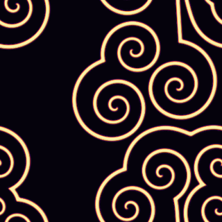

## Gallery

Every image below is one command, `morphogen --preset NAME --seed 42`.

| | | |
|---|---|---|
| 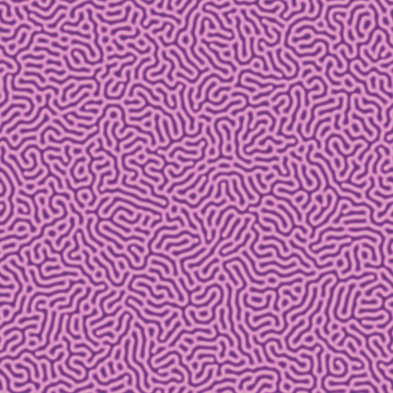<br>**coral** · Gray-Scott | 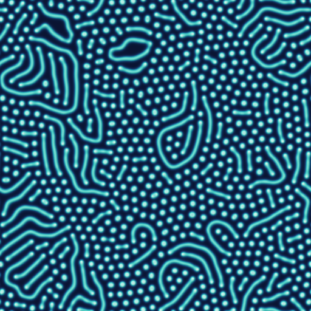<br>**mitosis** · Gray-Scott | <br>**zebra** · Gray-Scott, directional diffusion |
| 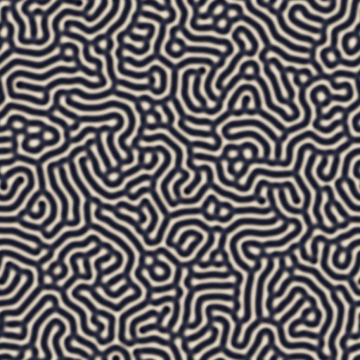<br>**fingerprint** · Gray-Scott | <br>**worms** · Gray-Scott | 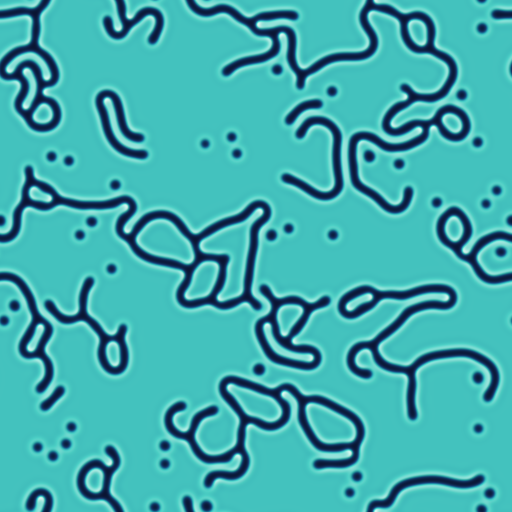<br>**bubbles** · Gray-Scott |
| <br>**atlas** · Gray-Scott parameter map | 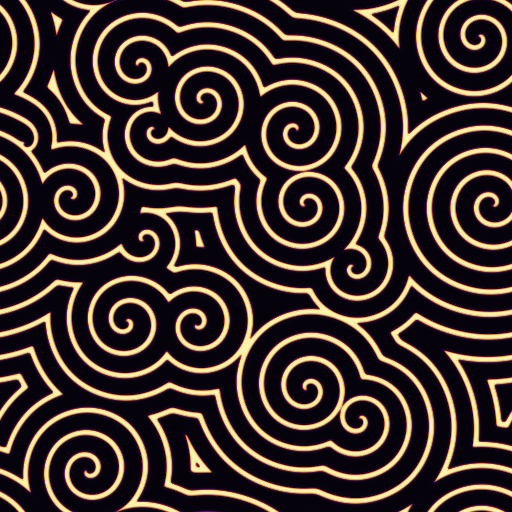<br>**spirals** · Barkley | 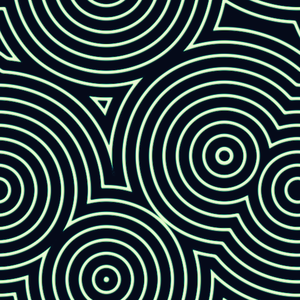<br>**targets** · Barkley with pacemakers |
| 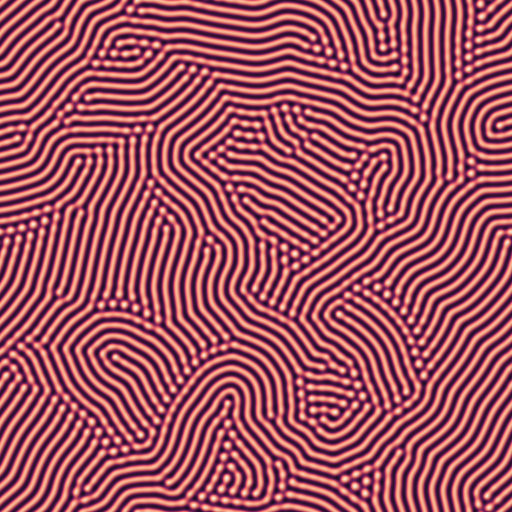<br>**dunes** · Brusselator | 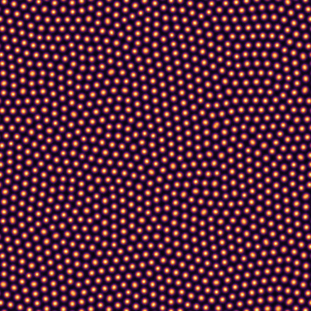<br>**leopard** · Schnakenberg | 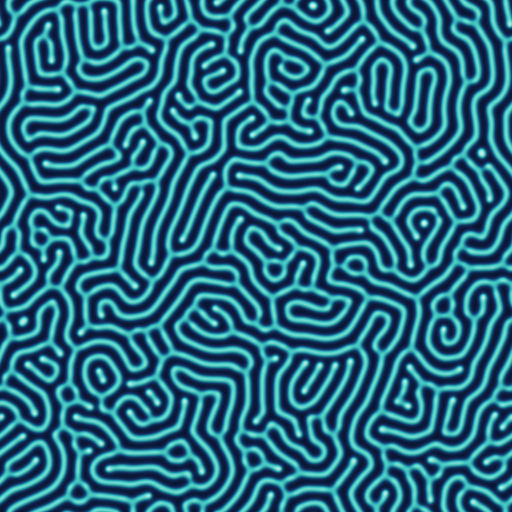<br>**maze** · Gierer-Meinhardt |
| 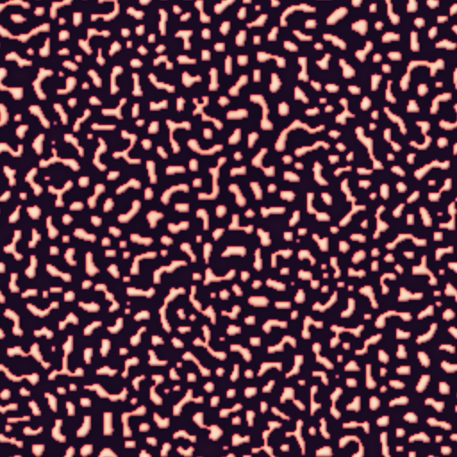<br>**cima** · Lengyel-Epstein | 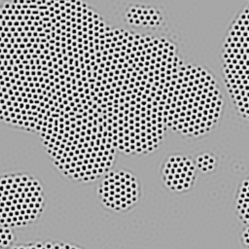<br>**honeycomb** · Thomas | 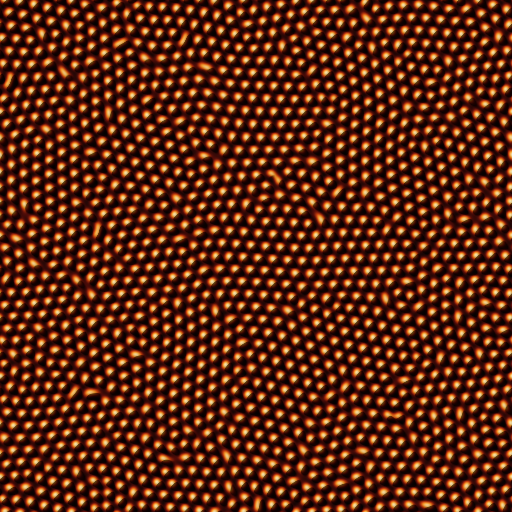<br>**benard** · Swift-Hohenberg |
| 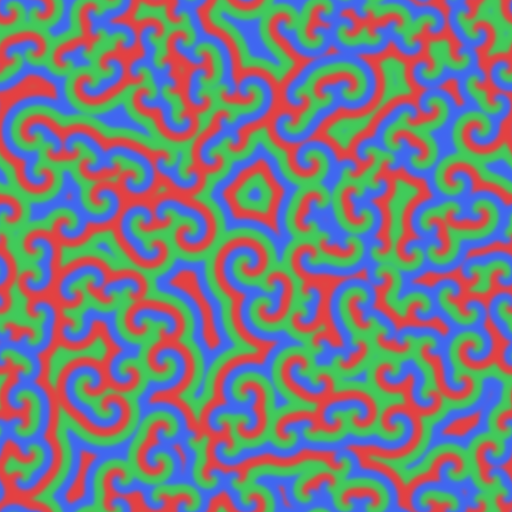<br>**rps** · May-Leonard | 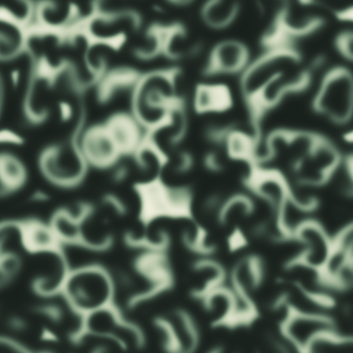<br>**predators** · Rosenzweig-MacArthur | |

## The models

Each cell holds the amounts of two chemicals (three for rock-paper-scissors). Every step, each cell reacts with itself and diffuses into its neighbours. The models differ only in the reaction terms.

| Model | What it describes | Presets |
|---|---|---|
| Gray-Scott | autocatalysis fed from a reservoir | coral, mitosis, zebra, fingerprint, worms, bubbles, atlas |
| Barkley | excitable media such as heart tissue | spirals, targets |
| Brusselator | a model autocatalytic reaction (Prigogine and Lefever) | dunes |
| Schnakenberg | the simplest reaction with Turing spots | leopard |
| Gierer-Meinhardt | activator and inhibitor, with saturation | maze |
| Lengyel-Epstein | the CIMA reaction, the first Turing pattern seen in a lab | cima |
| Thomas | an enzyme slowed down by its own substrate | honeycomb |
| Swift-Hohenberg | convection cells in a heated fluid | benard |
| May-Leonard | three species in a rock-paper-scissors cycle | rps |
| Rosenzweig-MacArthur | prey and predators with a saturating appetite | predators |

Gray-Scott, for example, is

```
U' = U + (Du ∇²U − U·V² + f·(1 − U))·dt
V' = V + (Dv ∇²V + U·V² − (k + f)·V)·dt
```

with the 9-point Laplacian (centre −1, edges 0.2, corners 0.05) on a grid that wraps around at the edges. The equations for every model are written out above its kernel in `Sources/MorphogenCore/Shaders/`, along with what each constant does.

## How it works

The field lives in two `rgba32Float` textures. Each step reads one and writes the other, so a run of 10,000 steps is 10,000 dispatches in one command buffer. The pipeline is:

1. `seed_field` places the starting state: Gray-Scott spots or noise, broken wavefronts for spirals, pacemaker discs, or a model's uniform steady state plus noise. Where a steady state has no closed form (Gierer-Meinhardt, Thomas), the shader solves for it with Newton's method.
2. One step kernel per model advances the field. Zebra uses an anisotropic diffusion tensor with a sign-aware cross-derivative stencil, so its stripes follow a chosen angle without the grid falling into a checkerboard. Swift-Hohenberg needs the Laplacian of the Laplacian, a 13-point stencil.
3. `field_stats` and `fold_stats` compute the range of both chemicals in two tree reductions on the GPU, so colours always span the whole palette.
4. `colorize` box-filters the field when the image is smaller than the grid, maps it onto a palette, and lights it as a height field in linear light.

## Build and run

Needs macOS 13 or later and Xcode's Swift toolchain. There are no dependencies.

```bash
swift build -c release
.build/release/morphogen --preset spirals --size 768 --out spirals.png
```

```bash
.build/release/morphogen --preset rps --gif rps.gif --frames 90 --gif-size 384
```

```bash
.build/release/morphogen --list
```

| Option | Meaning |
|---|---|
| `--preset NAME` | one of the 17 presets (default `coral`) |
| `--size N`, `--width W --height H` | grid size (default 1024) |
| `--steps N` | simulation steps (default: the preset's) |
| `--feed F --kill K` | Gray-Scott feed and kill rates |
| `--palette NAME` | `ocean`, `magma`, `coral`, `ink`, `mono`, `ember`, `sage`, `dusk`, `aurora` |
| `--style NAME` | `flat`, `emboss`, `glossy`, `phase`, `contour`, `relief`, `species` |
| `--zoom N` | upsample the PNG to show fine patterns larger |
| `--seed N` | random seed; the same seed gives byte-identical output |
| `--gif FILE` | also write an animation of the pattern forming |

`phase` colours each cell by where it is in the cycle between its two chemicals, so spiral arms sweep through every hue. `relief` treats the pattern as terrain and casts soft shadows by marching rays toward a low sun. `species` shows the three populations of `rps` as red, green and blue.

Every run prints its parameters and seed, and writes the same line into the PNG's description field, so any image can be reproduced.

## Tests

```bash
swift test
```

31 tests run on the GPU, and they test behaviour: every preset forms a pattern and stays finite, stripes follow the flow angle, Swift-Hohenberg picks the wavelength its operator predicts, spirals and predator-prey waves never settle, all three rock-paper-scissors species survive, and a downscaled image matches a box-filtered full-size one. Without a Metal device (some CI machines), the GPU tests are skipped instead of failing.

## License

MIT. See [LICENSE](LICENSE).
