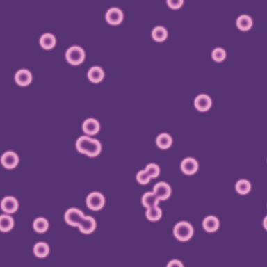
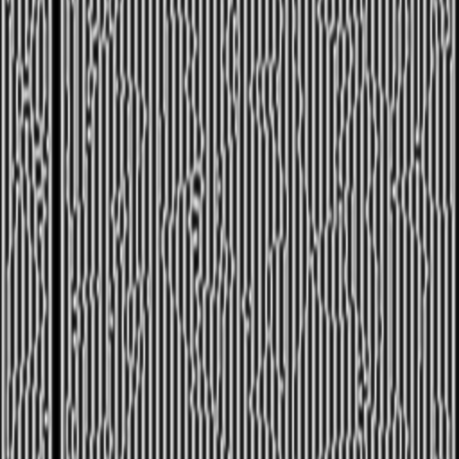
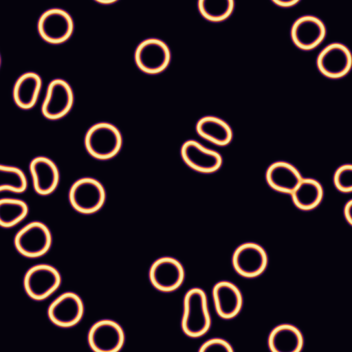

# morphogen

[](https://github.com/VivianSobers/morphogen/actions/workflows/ci.yml)

GPU Gray-Scott reaction-diffusion simulator and renderer written in Metal compute shaders.



## Gallery

| Coral | Mitosis | Zebra |
| :---: | :---: | :---: |
|  |  |  |
| **Fingerprint** | **Worms** | **Bubbles** |
|  |  |  |
| **Atlas** | | |
|  | | |

## How It Works

The Gray-Scott model simulates the non-linear interaction and diffusion of two chemical species, $U$ and $V$, governed by coupled reaction-diffusion partial differential equations:

$$\frac{\partial u}{\partial t} = D_u \nabla^2 u - u v^2 + f (1 - u)$$

$$\frac{\partial v}{\partial t} = D_v \nabla^2 v + u v^2 - (f + k) v$$

Here, $D_u$ and $D_v$ are diffusion coefficients ($D_u = 0.2097$, $D_v = 0.1050$), $f$ is the dimensionless feed rate replenishment of chemical $U$, and $k$ is the dimensionless kill rate conversion of chemical $V$. The non-linear reaction term $u v^2$ converts one unit of $U$ into $V$ catalyzed by two units of $V$.

Diffusion across the 2D spatial grid is discretized using an isotropic 9-point Laplacian convolution stencil:

```
[ 0.05  0.20  0.05 ]
[ 0.20 -1.00  0.20 ]
[ 0.05  0.20  0.05 ]
```

Boundary conditions are toroidal (periodic periodic boundary wrapping) computed with modulo index arithmetic.

### Kernel Pipeline

The simulation runs entirely on the GPU via Apple Metal compute shaders:
1. **Seeding (`seed_kernel`)**: Initializes the concentration state on a 2-channel 32-bit floating point texture (`RG32Float`). Background concentration starts at $u = 1.0, v = 0.0$. Organic seed disturbances (circular drops and multi-octave gradient noise) are placed deterministically using a PCG pseudo-random generator keyed by the user seed.
2. **Ping-Pong Time Stepping (`simulate_kernel`)**: Integrates forward in time using two alternating `RG32Float` textures across double-buffered compute dispatches. Multiple simulation steps are batched per command buffer submission for maximum GPU occupancy.
3. **Reduction (`stats_kernel`)**: Evaluates global minimum, maximum, sum, and variance across the concentration field using parallel threadgroup hierarchical shared-memory reductions.
4. **Colorize & Lighting (`colorize_kernel`)**: Renders the concentration field into an 8-bit RGBA texture. It computes central-difference spatial surface normals from chemical $V$ to perform Blinn-Phong specular highlighting, diffuse directional shading, smooth piecewise-cubic multi-stop palette mapping, ACES tone reproduction, and transfer to sRGB.

## Installation & Build

Build the optimized release binary with Swift Package Manager:

```bash
swift build -c release
```

The compiled binary will be placed at `.build/release/morphogen`.

## Usage

### Single Still Image

```bash
swift run morphogen --preset coral --palette ocean --size 768 --steps 8000 -o out.png
```

### Animated GIF

```bash
swift run morphogen --preset mitosis --palette neon --size 512 --frames 120 --step-stride 50 --gif-size 384 -o growth.gif
```

### Verbose Mode & Diagnostics

```bash
swift run morphogen --preset zebra --steps 4000 --verbose
```

### Options

- `--preset <name>`: Preset configuration (`coral`, `mitosis`, `zebra`, `fingerprint`, `worms`, `bubbles`, `atlas`). Default: `coral`.
- `--palette <name>`: Color palette (`viridis`, `magma`, `inferno`, `plasma`, `ocean`, `neon`, `mono`). Default: preset default.
- `--size <int>`: Simulation grid resolution in pixels ($N \times N$). Default: `512`.
- `--steps <int>`: Total simulation steps to execute. Default: `8000`.
- `--seed <int>`: Random seed for procedural perturbation. Default: `42`.
- `--feed <float>`: Override feed rate $f$.
- `--kill <float>`: Override kill rate $k$.
- `--frames <int>`: Number of animation frames to output (renders GIF when specified).
- `--step-stride <int>`: Simulation steps between consecutive animation frames. Default: `50`.
- `--gif-size <int>`: Frame resolution for GIF rendering. Default: `--size`.
- `-o, --output <path>`: Destination path (`.png` or `.gif`). Default: `output.png`.
- `--verbose`: Print per-phase timing, kernel statistics, and throughput.

## Presets

| Preset | Feed ($f$) | Kill ($k$) | Default Steps | Description |
| :--- | :--- | :--- | :--- | :--- |
| `coral` | 0.0545 | 0.0620 | 8000 | Branching labyrinthine dendritic coral reef growth |
| `mitosis` | 0.0360 | 0.0630 | 9000 | Self-replicating dividing circular biological cells |
| `zebra` | 0.0240 | 0.0500 | 7000 | Interlocking striped morphogenesis skin patterns |
| `fingerprint` | 0.0300 | 0.0560 | 8000 | Coaligned parallel ridge and valley contours |
| `worms` | 0.0580 | 0.0650 | 8000 | Slender writhing vermicular segmented filaments |
| `bubbles` | 0.0180 | 0.0510 | 7000 | Solitary oscillating localized spherical vesicles |
| `atlas` | 0.0250 | 0.0600 | 8000 | Organic topographic islands and continental voids |

## Palettes

- `viridis`: Perceptually uniform progressive blue-green-yellow colormap.
- `magma`: Deep velvet black to radiant solar white and orange.
- `inferno`: Dark obsidian purple to intense incandescent yellow.
- `plasma`: Saturated electric violet to vibrant red-orange.
- `ocean`: Deep midnight abyss to aquatic azure and coastal teal.
- `neon`: Cyberpunk ultraviolet, hot magenta, and electric cyan.
- `mono`: Minimalist scientific grayscale luminance mapping.

## Determinism

The simulation is fully bit-exact and deterministic across runs for any given combination of seed, resolution, and step count. The initial chemical perturbations are synthesized entirely on the GPU using a 32-bit PCG pseudo-random generator with fixed floating-point math, free from host-platform nondeterminism.

## Running Tests

Execute the XCTest suite:

```bash
swift test --disable-sandbox
```

## License

MIT License. See [LICENSE](LICENSE) for details.
